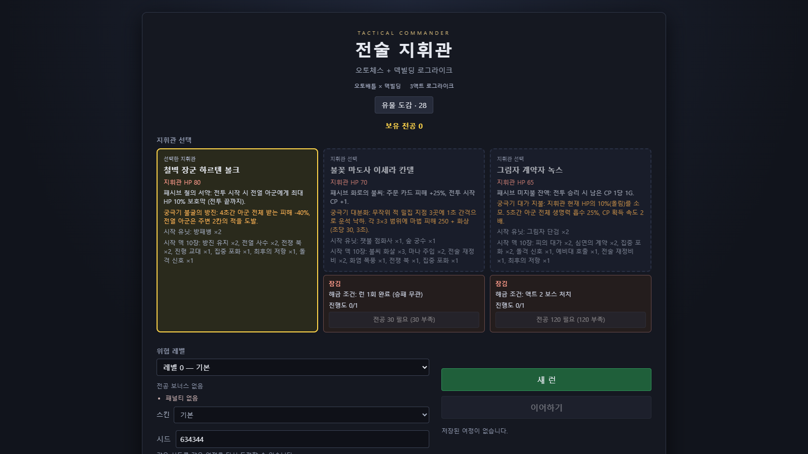
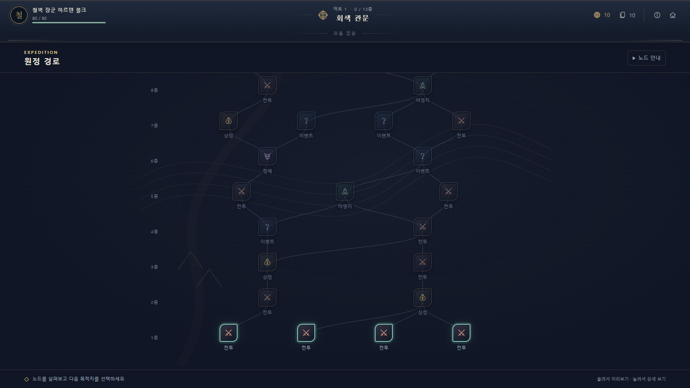
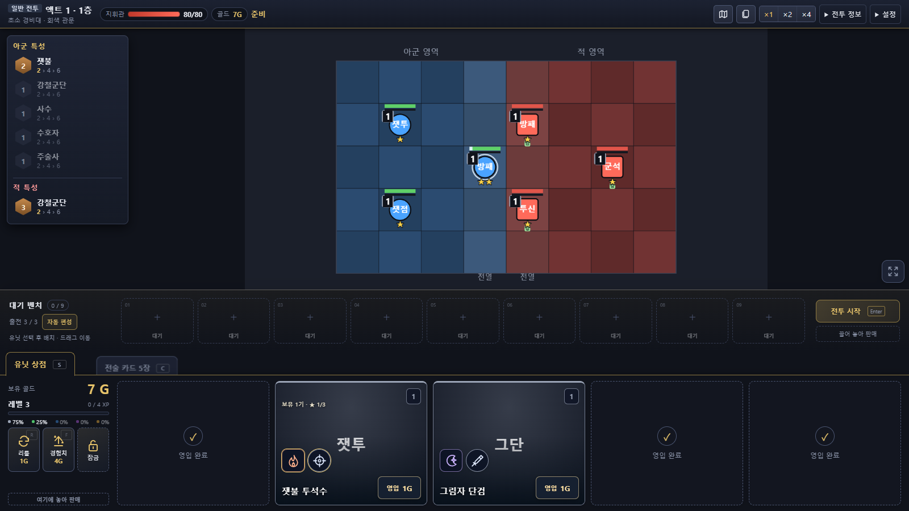
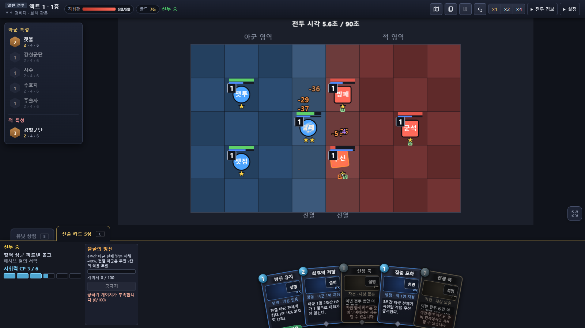
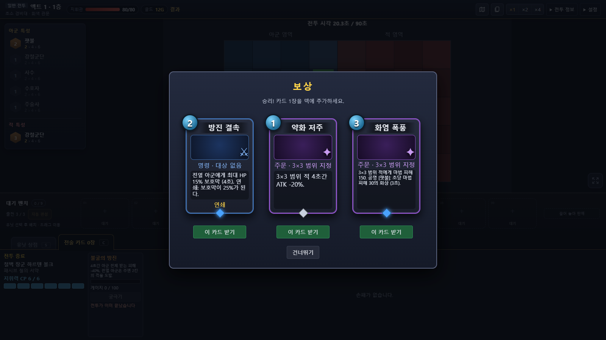

# 전술 지휘관 (가제)

오토체스와 덱빌딩 카드게임을 합친 **PvE 로그라이크 웹 게임**입니다. 유닛을 사서 보드에 배치하면 전투는 자동으로 진행되고, 지휘관은 전투 중에 전술 카드와 궁극기로 흐름을 바꿉니다. 3액트(액트당 13층)의 맵을 따라 올라가며 골드·유닛·덱·유물을 키워 마지막 보스를 쓰러뜨리는 것이 목표입니다.

- **바로 플레이:** https://park-jong.github.io/autobattle/
- 기술: TypeScript · Vite · Phaser 3 (보드·유닛) + HTML/CSS (UI)



## 화면

| 원정 경로 | 전투 준비 |
|---|---|
|  |  |
| **전투** | **카드 보상** |
|  |  |

> 스크린샷은 `기본` 스킨(진영색 도형·이름 약자)입니다. 시작 화면의 스킨 선택에서 마도아카데미·시티 오퍼레이션·연화삼국 원화 테마로 바꿀 수 있으며, 스킨은 표시만 바꾸고 게임 규칙은 같습니다.

## 게임 소개

### 한 판의 흐름
1. **지휘관 선택** — 하르텐·이세라·녹스 중 한 명. 지휘관마다 HP, 패시브, 궁극기, 시작 유닛, 시작 덱(10장)이 다릅니다.
2. **원정 경로** — 층마다 갈래길에서 다음 노드를 고릅니다. 전투·정예·상점·이벤트·야영지가 있고 13층에는 액트 보스가 기다립니다.
3. **전투 준비** — 유닛 상점에서 유닛을 사고(같은 유닛 3기 = 2성, 2성 3기 = 3성) 8×5 보드의 아군 진영에 배치합니다. 준비 단계에서도 작전 카드를 쓸 수 있습니다.
4. **전투** — 유닛은 자동으로 싸우고, 지휘관은 CP를 써서 손패의 카드를 끌어다 쓰거나 궁극기를 발동합니다. 카드를 집는 동안에는 시간이 느려집니다.
5. **보상** — 승리하면 골드·경험치·카드 3장 중 1장을, 정예는 유물도 줍니다. 지면 지휘관 HP를 잃고, HP가 0이 되면 런이 끝납니다.
6. **액트 전환** — 보스를 쓰러뜨리면 보스 유물을 고르고 HP를 일부 회복한 뒤 다음 액트로 넘어갑니다. 액트 3 보스를 쓰러뜨리면 승리입니다.

### 주요 요소
| 요소 | 내용 |
|---|---|
| 지휘관 | 3명. 각자의 패시브·궁극기·전용 카드 30장 |
| 유닛 | 상점 유닛 30종(등급 1~5: 8/8/6/5/3종) + 보스 전용 4기 |
| 특성 | 9개(강철군단·잿불·심연·숲의 맹약·수호자·검투사·사수·주술사·암살자). 같은 특성 유닛 2·4·6종으로 단계가 오름 |
| 카드 | 143종(공용 보상 카드·지휘관 전용 카드·유닛 제공 카드·저주) + 카드 강화 |
| 유물 | 28개(일반 9·희귀 8·보스 11) |
| 적 | 액트별 일반·정예 편성, 정예 변이 4종(장갑·분노·전파·방해), 패턴이 있는 보스 3종 |
| 메타 진행 | 런을 마치면 전공 포인트를 얻어 지휘관·유물을 해금 |
| 위협 레벨 | 승리할 때마다 1~10 단계의 추가 난이도가 열림 |

### 조작
| 동작 | 방법 |
|---|---|
| 유닛 배치·이동 | 벤치·보드 사이로 드래그, 판매 구역에 놓으면 판매 |
| 카드 사용 | 카드를 클릭한 뒤 대상 클릭, 또는 보드로 드래그 (우클릭·Esc 취소) |
| 전투 시작 | `Enter` |
| 상점 / 카드 층 전환 | `S` / `C` |
| 리롤 / 경험치 구매 | `R` / `F` |
| 궁극기 | `U` |

진행 상황은 브라우저에 자동 저장되어 "이어하기"로 다시 열 수 있습니다.

## 개발

Node.js 22에서 개발·확인했습니다.

```bash
npm install
```

```bash
npm run dev
```

개발 서버는 http://localhost:5738 에서 열립니다(포트 고정, 이미 쓰고 있으면 실패).

| 명령 | 설명 |
|---|---|
| `npm run dev` | 개발 서버 (포트 5738) |
| `npm run build` | 타입 검사 후 프로덕션 빌드 (`dist/`) |
| `npm run preview` | 빌드 결과 미리보기 |
| `npm test` | 테스트 실행 (Vitest) |
| `npm run typecheck` | 타입 검사 (`tsc --noEmit`) |
| `npm run sim -- --a A.json --b B.json --n 1000 --seed 1` | 헤드리스 전투 시뮬: 편성 A 대 B의 승률·평균 시간 |
| `npm run run -- --seed 1 --n 20` | 헤드리스 자동 런: 단순 정책으로 3액트를 끝까지 진행한 결과 통계 |
| `npm run deploy` | 빌드 후 GitHub Pages(`gh-pages` 브랜치)에 배포 |

헤드리스 도구의 옵션(지휘관·카드 계획·위협 레벨 등)은 [CLAUDE.md](CLAUDE.md)의 명령어 표에 정리되어 있습니다.

### 폴더 구조
```
data/        게임 콘텐츠 JSON (카드·유닛·특성·지휘관·유물·적 편성·이벤트·메타·위협 레벨)
src/core/    Phaser에 의존하지 않는 순수 로직 (전투 시뮬·덱·경제·상점·런 진행·메타)
src/ui/      Phaser 씬과 HTML/CSS 화면 (전투·런·스킨)
tools/       헤드리스 밸런스 도구 (전투 시뮬·자동 런)
public/      스킨 원화 축소본
```

### 설계 원칙
- **결정론:** 전투·런은 시드 기반 RNG만 쓰므로 같은 입력이면 같은 결과가 나옵니다. 전투는 이벤트 로그를 남기고 UI가 그 로그를 재생합니다.
- **데이터 주도:** 콘텐츠는 `data/*.json`에 두고 읽을 때 항상 검증합니다(위치가 담긴 한국어 오류 메시지).
- **로직과 화면 분리:** `src/core`는 Phaser·DOM을 모르며, 화면은 세션 인터페이스만 구독합니다.

## 문서
- [DESIGN.md](DESIGN.md) — 게임 설계와 구현 구조
- [ROADMAP.md](ROADMAP.md) — 마일스톤과 체크리스트
- [CHARACTERS.md](CHARACTERS.md) — 세계관·지휘관·유닛 설정
- [data/README.md](data/README.md) — 데이터 파일 형식과 규칙·수치
- [CHANGELOG.md](CHANGELOG.md) — 버전별 변경 내역
- [CLAUDE.md](CLAUDE.md) — 개발 상세 메모(구조·규칙·명령어)
